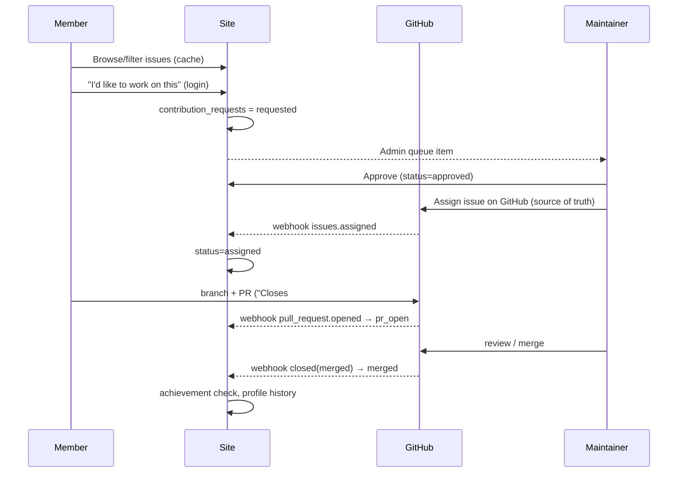

# GitHub Integration

> §6 of the OSS Club Website PRD
> Related docs: [PRD](./PRD.md) · [ARCHITECTURE](./architecture.md) · [DATABASE_SCHEMA](./DATABASE_SCHEMA.md)

---

## 6.1 GitHub App (recommended over plain OAuth App)

**Reasons:** org-level installation, fine-grained permissions, short-lived tokens (1 h), higher rate limits that scale with org size, per-installation webhooks, no personal tokens.

**Permissions (minimum):**
- Repository — Metadata R, Issues **R/W**, Pull requests R, Contents R (README only), Actions none
- Organization — Members R

**Events:** `issues`, `issue_comment`, `pull_request`, `pull_request_review`, `repository`, `label`, `member`, `organization`, `installation`, `installation_repositories`.

**Install workflow:**
1. Org owner creates App → installs on `Open-Source-Software-Club` (all repos or selected)
2. Copy App ID, private key (PEM), webhook secret to Vercel env
3. Set webhook URL `https://<domain>/api/webhooks/github`
4. `/admin/github` page shows install health (last webhook, last reconcile, rate-limit remaining)

**Tokens:** sign App JWT (RS256, 9-min) → `POST /app/installations/{id}/access_tokens` → cache token in memory with expiry − 5 min; never persisted, never sent to browser. Use `@octokit/app` + `@octokit/plugin-throttling` + `plugin-retry`.

**Revocation:** `installation` `deleted/suspend` webhook → flag sync disabled, show admin banner; cached data shown with "stale" badge. Rotating private key: documented runbook.

**User identity vs privilege:** user OAuth token (Supabase) used only at login; **not stored**; all org actions use the App.

---

## 6.2 Label taxonomy → metadata mapping

Labels live **in GitHub** (single source). `labels-sync.yml` ensures them across all repos (one-way, idempotent).

| Group | Labels | Website field |
|---|---|---|
| Difficulty | `good first issue`, `difficulty: beginner`, `difficulty: intermediate`, `difficulty: advanced` | `difficulty` (`good first issue`→beginner) |
| Area | `area: frontend/backend/fullstack/docs/devops/testing/design/security` | `areas[]` |
| Type | `type: bug/enhancement/feature/docs/refactor/maintenance` | `issue_type` |
| Skills | `skill: <name>` (e.g. `skill: react`) | `skills[]` |
| Workflow | `needs triage`, `blocked`, `needs review` | status chips |

**Do not recreate status.** "Available" = open + no assignees + no `blocked`. "In progress" = has assignee or linked open PR. "Needs review" = linked PR with review requested. All derived from GitHub state — no custom status column.

Parsing rule: first match wins by precedence; multiple difficulty labels → highest wins and sync logs a warning shown to admins as a "label hygiene" issue.

---

## 6.3 Synchronisation

| Data | Mode | Freshness |
|---|---|---|
| Repos list/meta | Webhook (`repository`) + reconcile 6 h | ≤ 1 min / 6 h worst |
| Issues | Webhook (`issues`, `label`) + reconcile 15 min | ≤ 1 min / 15 min |
| PRs & review state | Webhook (`pull_request*`) + reconcile 15 min | ≤ 1 min / 15 min |
| Stars/forks/languages | Reconcile daily | ≤ 24 h |
| README/docs | On-demand fetch, ISR 1 h | ≤ 1 h |
| Org membership | login + `member` webhook | event-driven |

UI shows "Updated 3 min ago" from `synced_at`; a global banner if `sync_state.last_ok_at` > 1 h.

### Webhook handler `/api/webhooks/github`

1. Read **raw body**; verify `X-Hub-Signature-256` with HMAC-SHA256 + `timingSafeEqual`; reject 401.
2. Insert `X-GitHub-Delivery` into `webhook_deliveries` (PK) → duplicate ⇒ 200 no-op (idempotent).
3. Route by `X-GitHub-Event`; upsert into `gh_*`; update `contribution_requests` (assignee matches requester → `assigned`; linked PR opened → `pr_open`; merged → `merged` + achievement check).
4. Return 200 fast (<10 s); heavy work deferred to reconcile. On failure: 500 so GitHub redelivers; admin can redeliver from App settings.

### Reconcile `/api/cron/reconcile`

`Authorization: Bearer $CRON_SECRET`. For each repo: GraphQL page through open issues/PRs `updatedAt >= last_ok_at − 10min`, use `sync_state.etag` for REST conditional requests (304s don't count against limit), mark missing items closed.

**Scheduler:** Vercel Cron if plan allows frequency; otherwise a GitHub Actions `schedule:` workflow `curl`s the endpoint (free, 5-min minimum).

### Rate-limit handling

App tokens ≈ 5,000 req/h baseline (scales up with org size). Prefer GraphQL (cost-based) for bulk; honour `retry-after`/`x-ratelimit-reset`; throttling plugin; circuit-breaker flag in `sync_state`; page loads **never** call GitHub directly except README fetch (cached).

### Sample GraphQL (issues sync)

```graphql
query($org:String!,$cursor:String){
  organization(login:$org){ repositories(first:50,after:$cursor,orderBy:{field:PUSHED_AT,direction:DESC}){
    pageInfo{hasNextPage endCursor}
    nodes{ databaseId name nameWithOwner description url stargazerCount forkCount isArchived pushedAt
      languages(first:5){edges{size node{name}}}
      issues(first:100,states:OPEN,orderBy:{field:UPDATED_AT,direction:DESC}){
        pageInfo{hasNextPage endCursor}
        nodes{ databaseId number title bodyText createdAt updatedAt url author{login}
          assignees(first:5){nodes{login}} labels(first:20){nodes{name}} } } } } } }
```

REST used for: create issue `POST /repos/{o}/{r}/issues`, add labels, org membership, README.

---

## 6.4 Contribution lifecycle



**Rule:** site "approved" ≠ assigned. Only a GitHub assignee event moves to `assigned`. Optional later: a button that assigns via the App (P3) — off by default.

**Stale policy:** `assigned` with no activity 14 days → maintainer prompt; never auto-unassign in MVP.

---

## 6.5 Issue creation

- **Admins:** form → Zod validate → `POST /issues` with App token → audit log.
- **Members:** proposal (rate limit 3 pending, dedupe by title similarity `pg_trgm` against open issues) → admin approval → create with idempotency key.
- **Visitors:** no creation.

Body sanitised; never include proposer private data; credit line `Proposed by @login via OSS Club site`.
